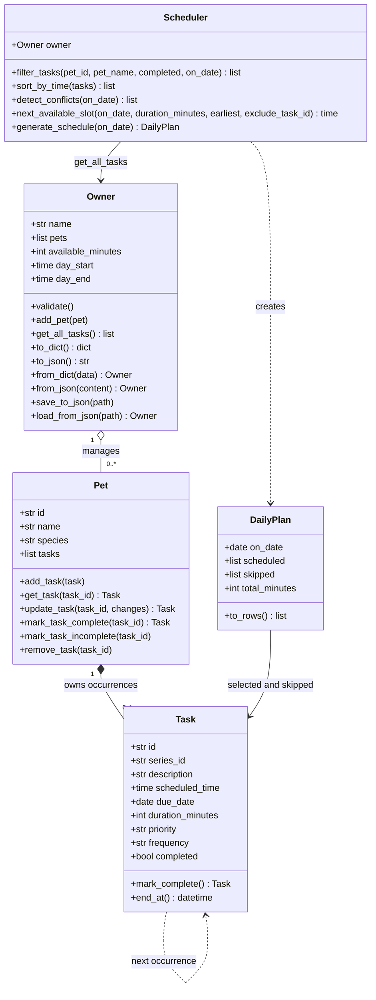

# 🐾 PawPal+

### Smart pet care, thoughtfully planned

[](https://github.com/harshapriyag123/ai110-module2show-pawpal-starter/actions/workflows/tests.yml)


**Student:** Harsha Priya Ganapathy  
**Course:** CodePath AI110 — Foundations of AI Engineering  
**Submission:** Project 2 · PawPal+  
**Rubric:** 20 required points + 10 possible bonus points

PawPal+ is a Python and Streamlit application that helps an owner manage care for multiple pets. It organizes walks, feeding, grooming, reminders, and appointments into an explained daily plan that respects time, priority, and availability. Completed routines create their next occurrence, and the complete household is saved to JSON for the next application run.

I built the project around a clear separation of responsibilities: **design the model, implement the backend, demonstrate it in the CLI, test its behavior, and connect the same logic to an interactive interface.**

| Project highlights | Delivered behavior |
|---|---|
| Modular OOP | Four required dataclass models and a dedicated `DailyPlan` result class |
| Multi-pet workflow | One owner, two pets, and five initial tasks in the CLI demo |
| Scheduling | Sorting, filtering, interval conflicts, recurrence, priority selection, care budgets, and next-free-slot search |
| Durable data | Automatic JSON save/load, downloadable household backups, and validated restoration |
| Automated tests | **107 passing cases**, including backend, CLI, persistence, gap finding, and Streamlit integration |
| Statement coverage | **100%** for `pawpal_system.py`; **98%** combined backend and CLI |
| AI collaboration | Recorded agent workflow and a structured comparison of two prompting/context strategies |

## Contents

- [Quick Start](#quick-start)
- [Features](#features)
- [System Design and UML](#system-design-and-uml)
- [Smarter Scheduling](#smarter-scheduling)
- [Data Persistence](#data-persistence)
- [Demo Walkthrough](#demo-walkthrough)
- [Sample Output](#sample-output)
- [Testing PawPal+](#testing-pawpal)
- [Rubric Evidence](#rubric-evidence)
- [AI Collaboration and Prompt Comparison](#ai-collaboration-and-prompt-comparison)
- [Project Files](#project-files)
- [Design Tradeoffs](#design-tradeoffs)

## Quick Start

**Requirements:** Python 3.11 or 3.12. Streamlit is pinned to version 1.67.0 in `requirements.txt`. The app does not require an API key.

### 1. Get the project

```bash
git clone https://github.com/harshapriyag123/ai110-module2show-pawpal-starter.git
cd ai110-module2show-pawpal-starter
python -m venv .venv
```

Activate the virtual environment:

| Terminal | Command |
|---|---|
| macOS / Linux / Git Bash | `source .venv/bin/activate` |
| Windows PowerShell | `.\.venv\Scripts\Activate.ps1` |
| Windows Command Prompt | `.venv\Scripts\activate.bat` |

### 2. Install dependencies

```bash
python -m pip install -r requirements.txt
```

### 3. Run the standalone demo

```bash
python main.py --date 2026-11-09
```

The fixed date reproduces the [sample output](#sample-output). Running `python main.py` without `--date` creates the demo for the current date.

### 4. Run the tests

```bash
python -m pytest
```

### 5. Open the application

```bash
python -m streamlit run app.py
```

Open the local URL printed by Streamlit, normally `http://localhost:8501`. In an empty household, **Load sample household** creates the two-pet example. The app automatically restores an existing `data.json` from the working directory.

## Features

| Feature | User experience |
|---|---|
| Household management | Add an owner and multiple pets with identifying information. |
| Task management | Add, edit, complete, undo, and delete individual care occurrences using stable IDs. |
| Flexible care details | Set a description, due date, start time, duration, priority, and once/daily/weekly frequency. |
| Clear daily plans | See selected tasks in chronological order, minutes used, and selection explanations. |
| Combined filters | Browse tasks by pet, pending/completed status, and selected/all dates. |
| Cross-pet conflict warnings | Identify equal-start and partial-duration overlaps across the entire household. |
| Next available slot | Find the earliest gap of a requested duration across all pets' pending tasks. |
| Recurring care | Completing a routine automatically creates and stores its next pending occurrence. |
| Durable household storage | Changes save to JSON; a fresh session loads pets, preferences, tasks, and history. |
| Portable backup and export | Download/restore household JSON or export a generated schedule as CSV. |

## System Design and UML

### Class responsibilities

| Class | Main attributes | Main responsibility |
|---|---|---|
| `Owner` | Name, pets, care budget, available hours | Represents the household, exposes all pets' tasks, and saves/loads the complete model. |
| `Pet` | ID, name, species, tasks | Owns task occurrences and handles add/edit/complete/undo/delete operations. |
| `Task` | ID, series ID, description, date/time, duration, priority, frequency, completion | Represents one care occurrence and creates its next recurring instance. |
| `Scheduler` | Owner reference | Retrieves, sorts, filters, detects conflicts, finds gaps, and selects daily plans across pets. |
| `DailyPlan` | Plan date, selected tasks, skipped tasks and reasons | Returns a structured plan, totals care time, and formats display/export rows. |

The core classes use Python dataclasses. `Owner.get_all_tasks()` is the shared retrieval boundary: the scheduler reads this method so every pet participates in its algorithms. The selected pet in the UI controls task editing; it does not limit household-wide scheduling.

Stable IDs distinguish pets or tasks with matching names. `series_id` connects related recurring occurrences while each occurrence retains its own task ID.

### Final class diagram

The initial design is preserved in [diagrams/uml_draft.mmd](diagrams/uml_draft.mmd). The final Mermaid source is [diagrams/uml_final.mmd](diagrams/uml_final.mmd), also retained at [diagrams/uml.mmd](diagrams/uml.mmd).



Completion methods return a new `Task` when a next occurrence is created, or `None` when no new occurrence is needed. The gap-finding method returns a start time or `None` if no interval fits.

### Backend and interface boundary

All domain logic lives in `pawpal_system.py`. Both `main.py` and `app.py` call that logic. Streamlit stores the `Owner` object in `st.session_state` during interactions and persists changes through `save_to_json()`. Plans are recalculated after edits and completion, keeping the display consistent with the current model.

## Smarter Scheduling

| Algorithm | Implementing method | Behavior |
|---|---|---|
| Chronological sorting | `Scheduler.sort_by_time()` | Sorts a copy by due date and time; preserves source collections and stable ties. |
| Combined filtering | `Scheduler.filter_tasks()` | Combines pet ID/name, completion status, and due-date criteria across the owner's tasks. |
| Interval conflict detection | `Scheduler.detect_conflicts()`, `_overlap()` | Detects overlapping pending task intervals on the same date, including different pets; adjacent tasks are allowed. |
| Daily/weekly recurrence | `Task.mark_complete()`, `Pet.mark_task_complete()` | Creates a new pending instance, preserves series identity, and attaches it to the same pet. |
| Priority selection | `Scheduler.generate_schedule()` | Considers high, medium, then low priority; uses start time and duration to break ties. |
| Time and budget constraints | `Scheduler.generate_schedule()` | Requires tasks to fit wholly within available hours and the remaining active-care budget. |
| Next available slot | `Scheduler.next_available_slot()` | Sorts and scans all pending intervals to find the earliest gap of the requested duration. |
| Explained results | `DailyPlan.to_rows()`, `DailyPlan.skipped` | Provides selection explanations and specific conflict, availability, or budget exclusions. |

### Daily selection procedure

1. Retrieve all pets' tasks through `Owner.get_all_tasks()`.
2. Select pending tasks due on the chosen date.
3. Consider candidates by priority, time, and duration.
4. Accept a task only when its full interval fits available hours, avoids already selected tasks, and fits the remaining budget.
5. Keep excluded tasks pending with a reason, then display selected tasks chronologically.

For example, a high-priority 08:00 walk and a medium-priority 08:00 breakfast conflict across two pets. The planner selects the walk and reports the breakfast clash. A low-priority 20-minute grooming task is excluded if only 15 minutes remain.

### Gap finding

The next-slot algorithm begins at the later of the requested earliest time and the owner's available start. It scans pending task intervals in time order, advances past occupied intervals, and returns the first sufficiently large gap. Overlapping occupied intervals are effectively merged during the scan.

The algorithm considers every pet, ignores completed tasks and other dates, and can exclude the task currently being edited. It suggests a time without moving existing care tasks. Budget and priority selection apply separately when generating the plan.

### Recurring task behavior

Daily tasks advance from their due date by **one day**; weekly tasks advance by **seven days**. The completed occurrence remains in history. The next occurrence receives a new task ID, the same series ID, the same care details, and pending status.

Applications call `Pet.mark_task_complete(task.id)` to create and store the next occurrence together. Repeated completion is idempotent. Undoing and recompleting reuses an existing next occurrence rather than duplicating it.

## Data Persistence

### Automatic application storage

The Streamlit app loads `data.json` when a new session starts and saves after household changes, including preferences, pets, task edits, completion, undo, and deletion. The JSON file preserves:

- Owner preferences and all pets.
- Task IDs, series IDs, descriptions, dates, times, durations, priorities, and frequencies.
- Completed occurrences and generated future occurrences.

The storage implementation uses `Owner.to_dict()`, `from_dict()`, `to_json()`, `from_json()`, `save_to_json()`, and `load_from_json()` in [pawpal_system.py](pawpal_system.py).

### Save and load from the CLI

```bash
# Create the demo, demonstrate recurrence, and save the complete household
python main.py --date 2026-11-09 --save data.json

# Start a separate run using the saved household
python main.py --date 2026-11-10 --load data.json
```

The first command saves six task occurrences: the five initial tasks plus the new daily walk created after completion. The second command restores the saved model and plans the next date. Loading a saved household does not automatically complete its tasks.

Actual save/load output, showing the save confirmation and the subsequent run:

```text
Saved household: data.json
Today's Schedule | 2026-11-10 | Jordan
Pets: Mochi (dog), Luna (cat)
All pending tasks, sorted by time:
  08:00 | Mochi: Morning walk
Luna's pending tasks: Breakfast, Medication reminder, Brush coat
Next free 15-minute slot from 08:00: 08:30
Priority-based plan:
  08:00–08:30 | Mochi: Morning walk | 30 min | high
Care budget: 30/75 minutes
```

### Backup and restoration

In **Household backup**, **Download household JSON** produces a portable copy. Uploading that file and selecting **Restore household** reconstructs the owner, pets, tasks, preferences, completion, and recurrence history. **Download plan as CSV** exports only the selected schedule and its explanations.

Backups use schema version 1. Restoration validates fields, dates, times, priorities, durations, and unique task ownership before replacing the active household. Backups are limited to 2 MB. Saving writes and flushes a temporary file before atomic replacement, so a failed write preserves the previous file. Unreadable saved data is preserved and shown as an error rather than silently overwritten.

The local installation serves one shared household. `PAWPAL_DATA_FILE` selects an alternate storage path; tests use isolated paths. Runtime `data.json` and temporary files are excluded from Git.

**Files involved:** `pawpal_system.py`, `app.py`, `main.py`, `.gitignore`, `tests/test_persistence.py`, `tests/test_app.py`, `tests/test_cli.py`, and `tests/conftest.py`.

## Demo Walkthrough

1. **Set up care preferences.** Enter an owner name, available hours, and remaining care minutes in the sidebar. Add two pets or load the sample household in an empty installation.
2. **Create care tasks.** Open **Pets & tasks**, select a pet, and enter the task's date, start time, duration, priority, and repeat frequency. **Create or edit** opens an existing pending occurrence for editing.
3. **Find a useful time.** Open **Find the next free time**, choose a duration and earliest start, then select **Find available slot**. The suggestion considers pending tasks for every pet.
4. **Generate the plan.** Choose a **Plan date** in **Daily plan**. Conflict warnings identify overlaps; **Generate schedule** displays chronological tasks, time totals, explanations, and excluded tasks needing attention.
5. **Track care.** Filter by pet, status, or date and mark a daily/weekly task complete. Its next dated occurrence appears automatically. Undo and individual deletion are available.
6. **Continue between runs.** Changes save automatically. A fresh application session restores the household. Household JSON supports backup/restore, while CSV preserves a generated plan.

The supplied demo uses Jordan, Mochi the dog, and Luna the cat. Five tasks are entered out of order, including a shared 08:00 clash and a task that exceeds the 75-minute care budget. This makes sorting, filtering, gap finding, conflict handling, priorities, and recurrence visible in one run.

## Sample Output

Command:

```bash
python main.py --date 2026-11-09
```

Actual CLI output:

```text
Today's Schedule | 2026-11-09 | Jordan
Pets: Mochi (dog), Luna (cat)
All pending tasks, sorted by time:
  08:00 | Mochi: Morning walk
  08:00 | Luna: Breakfast
  09:00 | Luna: Medication reminder
  18:00 | Mochi: Playtime
  19:00 | Luna: Brush coat
Luna's pending tasks: Breakfast, Medication reminder, Brush coat
WARNING: Morning walk overlaps Breakfast.
Next free 15-minute slot from 08:00: 08:30
Priority-based plan:
  08:00–08:30 | Mochi: Morning walk | 30 min | high
  09:00–09:10 | Luna: Medication reminder | 10 min | high
  18:00–18:20 | Mochi: Playtime | 20 min | medium
Care budget: 60/75 minutes
Needs attention:
  Luna: Breakfast - Conflicts with Mochi: Morning walk (high priority).
  Luna: Brush coat - Exceeds the remaining 15 minute care budget.
Completed Morning walk; new daily task: 2026-11-10 at 08:00 (pending).
```

The **08:30** free-slot suggestion follows the occupied 08:00–08:30 interval. The priority-based plan retains the walk, reminder, and playtime, uses **60 of 75 minutes**, and explains both excluded tasks. Completion then creates the next day's walk as a separate pending occurrence.

## Testing PawPal+

### Test commands

```bash
python -m pytest
python -m pytest --cov=pawpal_system --cov=main --cov-report=term-missing
```

### Test coverage by suite

| Suite | Passing cases | Behaviors covered |
|---|---:|---|
| [tests/test_pawpal.py](tests/test_pawpal.py) | 59 | Models, addition/completion, sorting, filters, recurrence, owner-wide retrieval, conflicts, priority/budget/hours, edits, and invalid values. |
| [tests/test_available_slot.py](tests/test_available_slot.py) | 10 | Gaps across pets, merged overlaps, adjacency, ignored completed/other-date tasks, editing exclusions, full calendars, and invalid durations. |
| [tests/test_persistence.py](tests/test_persistence.py) | 23 | Complete round trips, history/identity, schema validation, invalid files/values, Unicode, size limits, and failed atomic writes. |
| [tests/test_cli.py](tests/test_cli.py) | 4 | End-to-end output, save/load in separate processes, empty saved households, and invalid saved-file errors. |
| [tests/test_app.py](tests/test_app.py) | 11 | Forms/session state, multi-pet editing, plans/filters/completion, fresh-session restoration, corrupt-file preservation, and gap suggestions. |
| **Total** | **107** | Includes parameterized edge cases. |

### Passing test output

Actual local output from the coverage command:

```text
........................................................................ [ 67%]
...................................                                      [100%]

Name               Stmts   Miss  Cover
-------------------------------------
main.py               58      6    90%
pawpal_system.py     262      0   100%
-------------------------------------
TOTAL                320      6    98%

107 passed in 6.15s
```

The percentages measure backend and CLI **statement coverage**. Streamlit UI behavior is exercised using `AppTest`; the coverage percentages do not describe UI line coverage. Tests cover both normal workflows and failure cases, including month/year/leap-day recurrence boundaries, zero budget, exact and partial overlaps, failed disk operations, and invalid backups.

**Reliability confidence: ★★★★☆ (4/5)** for the documented single-household, same-day workflow.

### Continuous integration

[.github/workflows/tests.yml](.github/workflows/tests.yml) installs dependencies, runs the fixed-date CLI demo, and executes pytest with coverage on **Python 3.11 and 3.12**. The badge at the top links to the latest results.

## Rubric Evidence

### Required features — 20 possible points

| Rubric category | Points | Implemented evidence |
|---|---:|---|
| Clear, coherent UML | 4 | [Final `.mmd` source](diagrams/uml_final.mmd) contains all four required classes, attributes/methods, appropriate relationships, and the final storage/scheduling operations. The diagram is also rendered in this README. |
| Core classes match the design | 4 | [pawpal_system.py](pawpal_system.py) implements Task data/behavior, Pet task management, Owner pet management, and Scheduler algorithms using the owner's multi-pet task method. |
| At least two meaningful algorithms | 3 | Sorting, filtering, interval conflicts, recurrence, priority/constraint selection, and next-slot search are implemented across pets and covered by reproducible tests. |
| End-to-end demo | 3 | [main.py](main.py) creates one owner, two pets, five initial tasks, and demonstrates scheduler algorithms. Actual readable CLI output appears in a fenced block above. |
| Basic pytest suite | 3 | [tests/test_pawpal.py](tests/test_pawpal.py) includes meaningful completion, addition, sorting, filtering, and scheduling tests within the 107-case passing suite. |
| Documentation and AI reflection | 3 | This README describes classes/algorithms and provides setup, demo/test commands, coverage, and passing output. [reflection.md](reflection.md) records AI-influenced decisions and correctness evidence. |

### Stretch features — 10 possible bonus points

| Bonus category | Points | Implemented evidence |
|---|---:|---|
| Advanced algorithm via agent mode | +2 | `Scheduler.next_available_slot()` finds a gap across all pets' pending intervals. The CLI/UI expose it, dedicated tests cover it, and [Agent Workflow](ai_interactions.md#agent-workflow) records requested work, changed files, completion, and corrections. |
| Data persistence | +2 | `Owner.save_to_json()` / `load_from_json()` restore pets/tasks between runs. CLI save/load, UI autosave/restore, failed-write protection, and the complete persistence workflow are documented above. |
| Advanced scheduling | +2 | Priority-first selection, availability/budget constraints, and interval checks prevent overlaps among selected tasks. The CLI example shows the resulting choices and exclusions. |
| Professional UI and output | +2 | Structured CLI rows, formatted time ranges, emoji status, metrics, tabs, forms, warning/success feedback, expandable task cards, tables, and downloadable output are implemented. |
| Thorough model or prompt comparison | +2 | [Prompt Comparison](ai_interactions.md#prompt-comparison) compares broad versus complete-context strategies using the same AI assistant, with task inputs, outputs, useful elements, problems, evidence, and the final decision. |

### Formatting implementation

| Output feature | Function or library |
|---|---|
| Household and care counters | `st.metric()` |
| Navigation, task forms, and detail cards | `st.tabs()`, `st.form()`, `st.expander()` |
| Completion and conflict feedback | Emoji status icons, `st.success()`, `st.warning()`, `st.info()` |
| Plan and exclusion tables | `DailyPlan.to_rows()` and `st.dataframe()` |
| CSV plan export | Python `csv.DictWriter` and `st.download_button()` |
| JSON household backup/restore | `Owner.to_json()`, `Owner.from_json()`, `st.download_button()`, `st.file_uploader()` |
| CLI output | Python f-strings and date/time formatting in `main.main()` |
| Application theme | `.streamlit/config.toml` and static CSS in `app.py` |

## AI Collaboration and Prompt Comparison

I used ChatGPT Work to scaffold the OOP design, implement related files, generate behavioral tests, and connect the interface to the backend. The [Agent Workflow](ai_interactions.md#agent-workflow) identifies the task, files, completed work, and corrections.

The [Prompt Comparison](ai_interactions.md#prompt-comparison) examines the same recurrence-design problem under two context strategies:

- **Broad request with partial context:** useful for establishing the four classes, dataclasses, and owner-wide retrieval, but its completion-date-set representation did not demonstrate a new task instance.
- **Complete requirements with explicit behavior and tests:** led to dated task instances, preserved series identity, pet-level completion orchestration, and tests that assert the required outcomes.

I retained the simple class separation and adopted the second strategy for recurrence. The comparison uses the actual initial skeleton and later implementation checkpoints; both strategies used the same assistant. The full design, tradeoff, testing, and learning reflection is in [reflection.md](reflection.md).

## Project Files

| File | Purpose |
|---|---|
| [pawpal_system.py](pawpal_system.py) | Dataclass models, scheduling algorithms, recurrence, and JSON persistence. |
| [main.py](main.py) | Two-pet CLI demo with optional JSON save/load. |
| [app.py](app.py) | Interactive Streamlit application using the shared backend and automatic persistence. |
| [diagrams/uml_draft.mmd](diagrams/uml_draft.mmd) | Initial class design checkpoint. |
| [diagrams/uml_final.mmd](diagrams/uml_final.mmd) | Final Mermaid architecture source. |
| [tests/test_pawpal.py](tests/test_pawpal.py) | Core behavior and scheduling tests. |
| [tests/test_available_slot.py](tests/test_available_slot.py) | Next-slot algorithm tests. |
| [tests/test_persistence.py](tests/test_persistence.py) | JSON round-trip, validation, and failed-write tests. |
| [tests/test_cli.py](tests/test_cli.py), [tests/test_app.py](tests/test_app.py) | CLI and UI integration tests. |
| [tests/conftest.py](tests/conftest.py) | Isolated application storage during tests. |
| [reflection.md](reflection.md) | Structured project reflection. |
| [ai_interactions.md](ai_interactions.md) | Agent workflow and prompt-strategy comparison. |
| [requirements.txt](requirements.txt), [pyproject.toml](pyproject.toml) | Dependencies, pytest, and coverage settings. |
| [.github/workflows/tests.yml](.github/workflows/tests.yml) | Automated checks on supported Python versions. |

## Design Tradeoffs

| Design choice | Reason and boundary |
|---|---|
| Greedy priority selection | Produces predictable priorities and clear reasons; it does not guarantee a globally optimal task combination. |
| Pairwise conflict detection | Easy to inspect for a small household; O(n²) worst-case work. Sorting/filtering use O(n log n) / O(n), and gap finding uses O(n log n). |
| Fixed task times | Preserves intended care times. Gap suggestions support deliberate edits rather than silently rescheduling tasks. |
| One dated occurrence per Task | Keeps completion history explicit and creates only the next recurring instance. Missed tasks stay on their original dates and remain visible under **All dates**. |
| Single-household JSON storage | Persists local use without a database. A hosted multi-user version would need authentication, household isolation, and coordinated concurrent writes. |
| Same-day local availability | Keeps the first version understandable. Overnight windows, time zones, a bulk series editor, and a calendar view are future extensions. |
