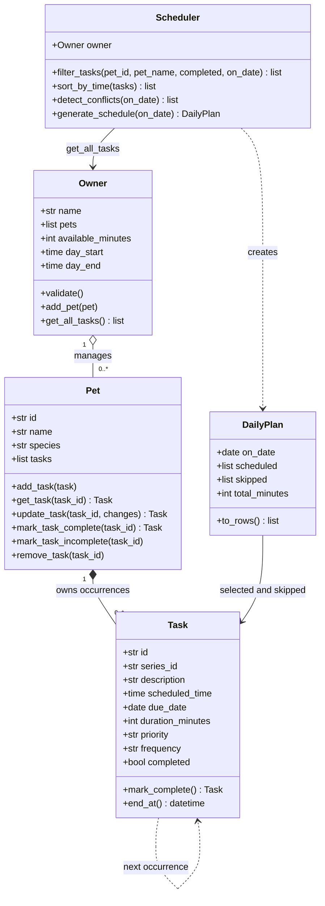

# 🐾 PawPal+

### Smart care planning for every pet in the household

[](https://github.com/harshapriyag123/ai110-module2show-pawpal-starter/actions/workflows/tests.yml)


**Student:** Harsha Priya Ganapathy  
**Course:** CodePath AI110 — Foundations of AI Engineering  
**Project:** Module 2 · Show What You Know: PawPal+  
**Rubric:** 20 required points + 10 possible bonus points

PawPal+ helps an owner manage daily care for multiple pets. Add walks, feeding, grooming, or reminders; assign dates, times, durations, and priorities; then generate a daily plan that fits the owner's available hours and care budget. The app explains both selected tasks and tasks needing attention.

The project follows a **UML → dataclass models → CLI demo → algorithms → automated verification → Streamlit integration** workflow. The Python backend runs independently of the UI.

| Review at a glance | Verified evidence |
|---|---|
| Household demo | 1 owner, 2 pets, 5 care tasks |
| Core design | `Owner`, `Pet`, `Task`, `Scheduler`, plus a `DailyPlan` result class |
| Algorithms | Chronological sorting, combined filters, interval conflict detection, recurrence, and constrained priority scheduling |
| Automated tests | **68 passing cases:** 59 backend, 1 CLI, 8 Streamlit UI |
| Statement coverage | **100%** of `pawpal_system.py`; **99%** combined backend + CLI |
| Continuous integration | [Passed on Python 3.11 and 3.12](https://github.com/harshapriyag123/ai110-module2show-pawpal-starter/actions/runs/42716513426) |

## Contents

- [Quick start](#quick-start)
- [Required rubric evidence](#required-rubric-evidence)
- [Features and user workflow](#features-and-user-workflow)
- [System architecture and OOP design](#system-architecture-and-oop-design)
- [Smarter Scheduling](#smarter-scheduling)
- [Demo Walkthrough](#demo-walkthrough)
- [Sample Output](#sample-output)
- [Testing PawPal+](#testing-pawpal)
- [Stretch feature evidence](#stretch-feature-evidence)
- [AI collaboration and design decisions](#ai-collaboration-and-design-decisions)
- [Project files](#project-files)
- [Scope and future improvements](#scope-and-future-improvements)

## Quick start

**Prerequisite:** Python 3.11 or 3.12. Local verification used Python 3.12.14 and Streamlit 1.67.0; CI also passed on Python 3.11. No API key or external AI service is required to run PawPal+.

### 1. Clone and create the environment

```bash
git clone https://github.com/harshapriyag123/ai110-module2show-pawpal-starter.git
cd ai110-module2show-pawpal-starter
python -m venv .venv
```

Activate the virtual environment using the command for your terminal:

| Terminal | Command |
|---|---|
| macOS / Linux / Git Bash | `source .venv/bin/activate` |
| Windows PowerShell | `.\.venv\Scripts\Activate.ps1` |
| Windows Command Prompt | `.venv\Scripts\activate.bat` |

### 2. Install dependencies

```bash
python -m pip install -r requirements.txt
```

### 3. Run the CLI demo

```bash
python main.py --date 2026-11-09
```

The fixed date makes the sample output reproducible. Running `python main.py` without the date uses the current date for the sample household.

### 4. Run the tests

```bash
python -m pytest
```

### 5. Launch the application

```bash
python -m streamlit run app.py
```

Open the local URL printed in the terminal, normally `http://localhost:8501`. Click **Load sample household** in an empty household for a ready-to-explore example, or add your own pets in the sidebar.

## Required rubric evidence

The following tables map the supplied **20-point required-feature rubric** to implementation and verification evidence. Each linked source file can be inspected directly.

### UML design — 4 points

| Rubric item | Points | Implementation evidence |
|---|---:|---|
| Includes `Owner`, `Pet`, `Task`, and `Scheduler` in Mermaid source | 1 | [Final UML source](diagrams/uml_final.mmd) and [initial UML source](diagrams/uml_draft.mmd) are committed `.mmd` files. |
| Classes list relevant attributes and methods | 1 | The final diagram includes task dates/status/recurrence, pet task management, owner preferences, and scheduler operations. |
| Appropriate relationships | 1 | Owner manages multiple pets; each pet owns task occurrences; Scheduler reads the owner's shared task collection. |
| Readable and consistent with the final implementation | 1 | The diagram includes the implemented `DailyPlan` result class and recurrence relationship; compare with [pawpal_system.py](pawpal_system.py). |

### Core class implementation — 4 points

| Rubric item | Points | Implementation evidence |
|---|---:|---|
| Task has description, due time/date, completion, and behavior | 1 | `Task` stores `description`, `scheduled_time`, `due_date`, `completed`, and implements `mark_complete()` and `end_at()`. |
| Pet has identifying data, task collection, and task methods | 1 | `Pet` stores ID/name/species/tasks and provides add, lookup, edit, complete, undo, and removal methods. |
| Owner has identifying data, pets, and management methods | 1 | `Owner` stores name/pets/preferences and implements `add_pet()`, `get_all_tasks()`, and `validate()`. |
| Scheduler operates across multiple pets | 1 | `Scheduler.filter_tasks()` retrieves through `Owner.get_all_tasks()`; sorting, conflicts, and planning use that combined collection. `test_scheduler_reads_every_pet_through_owner_method` verifies this retrieval path. |

All core classes are implemented in [pawpal_system.py](pawpal_system.py), with behavioral tests in [tests/test_pawpal.py](tests/test_pawpal.py).

### Meaningful scheduling algorithms — 3 points

| Rubric item | Points | Implementation evidence |
|---|---:|---|
| At least two algorithmic features | 1 | `sort_by_time()` and `filter_tasks()` are implemented, along with interval conflict detection, recurrence, and constrained priority selection. |
| Correct, reproducible behavior | 1 | Tests verify ordering, filters, overlapping and adjacent intervals, recurrence dates, stable ties, and budget boundaries. The CLI accepts a fixed date. |
| Features operate across multiple pets | 1 | The CLI sorts and plans tasks for Mochi and Luna together; conflict detection identifies their shared 08:00 clash. Cross-pet behavior is also tested. |

### End-to-end demo — 3 points

| Rubric item | Points | Implementation evidence |
|---|---:|---|
| `main.py` creates an owner, two pets, and 3+ tasks | 1 | `create_demo_owner()` creates Jordan, Mochi, Luna, and five tasks entered out of chronological order. |
| Demo uses a scheduler algorithm | 1 | The demo calls sorting, filtering, conflict detection, and priority-constrained plan generation. |
| Readable output and fenced README sample | 1 | [Sample Output](#sample-output) contains actual CLI output, including selected/skipped tasks and a newly created daily occurrence. |

Source: [main.py](main.py). Verification: [tests/test_cli.py](tests/test_cli.py).

### Pytest verification — 3 points

| Rubric item | Points | Implementation evidence |
|---|---:|---|
| Test file exists and has a passing test | 1 | [tests/test_pawpal.py](tests/test_pawpal.py) is included in the passing suite. |
| At least two meaningful passing tests | 2 | Tests verify completion, task addition, sorting, filtering, new recurring instances, cross-pet conflicts, and constraints. [Testing PawPal+](#testing-pawpal) includes commands, coverage, and passing output. |

### Documentation and AI reflection — 3 points

| Rubric item | Points | Submission evidence |
|---|---:|---|
| README explains the system, classes, and algorithms | 1 | [OOP design](#system-architecture-and-oop-design) and [Smarter Scheduling](#smarter-scheduling) document responsibilities, methods, and behavior. |
| Run/demo/test instructions, pytest command, coverage summary, passing output | 1 | [Quick start](#quick-start), [Sample Output](#sample-output), and [Testing PawPal+](#testing-pawpal). |
| Reflection explains AI influence, accepted/modified suggestions, and verification | 1 | [reflection.md](reflection.md) and [ai_interactions.md](ai_interactions.md) document the recurrence design change, AI assistance, and test evidence. Personal reflection statements are identified for student review. |

## Features and user workflow

| Owner action | What PawPal+ does |
|---|---|
| Register multiple pets | Keeps each pet's identifying information and care tasks in one household. |
| Add or edit a care task | Validates its description, date, start time, duration, priority, and repeat frequency. |
| View pending or completed work | Combines pet and status filters with selected-date or all-date views. |
| Generate a daily plan | Chooses tasks within the owner's available hours and remaining minutes, then displays them chronologically. |
| Resolve a scheduling clash | Warns about overlapping intervals and explains which task was excluded from the plan. |
| Complete repeating care | Keeps the completed occurrence and automatically attaches a new pending daily/weekly task. |
| Download the plan | Exports the selected schedule and its explanations as CSV. |

**Three core actions:** add a pet, manage its care tasks, and review/complete a daily schedule across the household.

## System architecture and OOP design

### Class responsibilities

| Class | Key state | Responsibility |
|---|---|---|
| `Owner` | Name, pets, care budget, available hours | Represents the household and exposes all pets' tasks through `get_all_tasks()`. |
| `Pet` | ID, name, species, task collection | Owns task occurrences and handles identity-safe task management. |
| `Task` | ID, series ID, description, date/time, duration, priority, frequency, completion | Represents one occurrence and creates its next daily/weekly instance on completion. |
| `Scheduler` | Owner reference | Retrieves, sorts, filters, detects conflicts, and selects a plan across pets. |
| `DailyPlan` | Plan date, selected tasks, skipped tasks/reasons | Returns the planning result, totals care minutes, and produces display/export rows. |

Dataclasses make model state explicit. Stable IDs distinguish tasks and pets with matching names. One-line method docstrings explain behavior. Domain logic stays in `pawpal_system.py`; both `main.py` and `app.py` use it.

### Final UML

The diagram below embeds the contents of [diagrams/uml_final.mmd](diagrams/uml_final.mmd). The original four-class design is preserved in [diagrams/uml_draft.mmd](diagrams/uml_draft.mmd).



`Task.mark_complete()` and `Pet.mark_task_complete()` return a `Task` when a next occurrence is available, or `None` when no new occurrence is produced.

### UI-to-backend integration

`app.py` stores an `Owner` in `st.session_state`. Forms call `Owner.add_pet()`, `Pet.add_task()`, and `Pet.update_task()`; completion calls `Pet.mark_task_complete()`. These objects survive normal Streamlit reruns. Displayed plans are recalculated from current state after edits, deletion, and completion.

The scheduler obtains tasks through the owner's method rather than reading a single selected pet. The UI's pet selection controls editing and filtering; it does not restrict household-wide conflict detection or plan generation.

## Smarter Scheduling

| Capability | Implementing method | Defined behavior |
|---|---|---|
| Chronological sorting | `Scheduler.sort_by_time()` | Sorts a copy by due date and start time; preserves stored task order and stable ties. |
| Combined filtering | `Scheduler.filter_tasks()` | Filters by pet ID/name, completion status, and due date, using all pets as the input collection. |
| Interval conflicts | `Scheduler.detect_conflicts()`, `_overlap()` | Reports overlapping pending tasks for the chosen date, including across pets; adjacent tasks are allowed. |
| Daily/weekly recurrence | `Task.mark_complete()`, `Pet.mark_task_complete()` | Creates a distinct pending occurrence, preserves its series ID, and stores it with the same pet. |
| Priority scheduling | `Scheduler.generate_schedule()` | Considers high, medium, then low priority; ties use start time and duration. |
| Constraint selection | `Scheduler.generate_schedule()` | Requires the entire task to fit the owner's hours and remaining active-care budget. |
| Explanations | `DailyPlan.to_rows()`, `DailyPlan.skipped` | Shows why a selected task fits and why a pending task was excluded. |

### Selection procedure

1. Retrieve every pet's tasks through `Owner.get_all_tasks()`.
2. Filter to pending tasks due on the selected date.
3. Consider tasks by priority, then start time, then duration.
4. Select a task if its full duration fits available hours, it does not overlap a selected task, and the remaining budget permits it.
5. Retain excluded tasks as pending with a reason, and return selected tasks in chronological order.

**Example:** a high-priority 08:00 walk and a medium-priority 08:00 breakfast overlap across two pets. The walk is selected and breakfast is flagged for attention. A later low-priority grooming task can also be excluded when only 15 minutes remain and it needs 20.

### Recurrence contract

Completing a **daily** occurrence creates a new task at **due date + 1 day**; **weekly** uses **+ 7 days**. The new task has a new ID, the same series ID, and pending status. The original remains completed.

```python
from datetime import date, time
from pawpal_system import Pet, Task

pet = Pet("Mochi", "dog")
task = Task("Morning walk", time(8), frequency="daily",
            due_date=date(2026, 11, 9))
pet.add_task(task)
next_task = pet.mark_task_complete(task.id)

assert task.completed
assert next_task is not None and not next_task.completed
assert next_task.id != task.id
assert next_task.due_date == date(2026, 11, 10)
assert next_task in pet.tasks
```

Applications use `Pet.mark_task_complete()` to attach the next occurrence automatically. Calling `Task.mark_complete()` directly returns the new task for the caller to store. Completing an already completed task does not create another instance. Undoing and recompleting reuses an existing next occurrence.

### Algorithm tradeoffs

Sorting uses Python's stable `sorted()` operation, **O(n log n)**. Filtering is **O(n)**. Pairwise conflict detection and conflict checks during selection are **O(n²)** in the worst case. These straightforward methods keep the implementation readable for a small household.

Priority selection is greedy: it favors higher-priority tasks and provides reasons, but does not guarantee the globally optimal number or combination of tasks. Fixed start times are preserved; the owner reviews conflicts and edits times deliberately.

## Demo Walkthrough

1. **Set up the household.** Enter an owner name, available hours, and remaining care budget in the sidebar, then save. Add two pets, or load the sample household while the household is empty.
2. **Create care activities.** Open **Pets & tasks**, select a pet, and add a description, due date, start time, duration, priority, and repeat frequency. Use **Create or edit** to change a pending occurrence.
3. **Inspect household-wide clashes.** Choose a **Plan date**. The **Daily plan** tab warns about exact-time clashes and partial duration overlaps across all pets.
4. **Generate the plan.** Click **Generate schedule**. Review the chronological table, minutes used, selection explanations, and tasks under **Needs your attention**.
5. **Filter and complete.** In **Your care list**, filter by pet/status/date and mark a daily or weekly task complete. Choose its next due date to inspect the new pending instance. Undo and individual deletion are available.
6. **Export the result.** Download the schedule as CSV. The **How it works** tab explains constraints and recurrence rules.

The sample household uses Jordan, Mochi the dog, and Luna the cat. Its five tasks are entered out of time order to demonstrate sorting. An 08:00 cross-pet clash demonstrates conflict detection; the 75-minute budget demonstrates priority selection and an explicit budget exclusion.

## Sample Output

Actual output from:

```bash
python main.py --date 2026-11-09
```

```text
Today's Schedule | 2026-11-09 | Jordan
Pets: Mochi (dog), Luna (cat)
All pending tasks, sorted by time:
  08:00 | Mochi: Morning walk
  08:00 | Luna: Breakfast
  09:00 | Luna: Medication reminder
  18:00 | Mochi: Playtime
  19:00 | Luna: Brush coat
Luna's pending tasks: Breakfast, Medication reminder, Brush coat
WARNING: Morning walk overlaps Breakfast.
Priority-based plan:
  08:00–08:30 | Mochi: Morning walk | 30 min | high
  09:00–09:10 | Luna: Medication reminder | 10 min | high
  18:00–18:20 | Mochi: Playtime | 20 min | medium
Care budget: 60/75 minutes
Needs attention:
  Luna: Breakfast - Conflicts with Mochi: Morning walk (high priority).
  Luna: Brush coat - Exceeds the remaining 15 minute care budget.
Completed Morning walk; new daily task: 2026-11-10 at 08:00 (pending).
```

This single run demonstrates **two-pet retrieval, chronological sorting, pet/status filtering, a conflict warning, priority-constrained scheduling, readable exclusions, and a newly created daily task**.

## Testing PawPal+

### Commands

```bash
# All backend, CLI, and Streamlit UI tests
python -m pytest

# Backend + CLI statement coverage
python -m pytest --cov=pawpal_system --cov=main --cov-report=term-missing
```

### Verification evidence

| Suite | Passing cases | What it verifies |
|---|---:|---|
| [tests/test_pawpal.py](tests/test_pawpal.py) | 59 | Models, task addition/completion, sorting, filters, recurrence, owner-wide retrieval, conflicts, priority/constraints, edits, and invalid inputs. |
| [tests/test_cli.py](tests/test_cli.py) | 1 | The demo prints the two-pet workflow, a conflict, care-budget totals, and a new recurring occurrence. |
| [tests/test_app.py](tests/test_app.py) | 8 | Actual Streamlit forms/session state, multiple pets, validation, task editing, plan display, completion, deletion, filters, and preferences. |
| **Total** | **68** | Includes parameterized edge cases. |

Examples of meaningful tests:

| Behavior | Named test |
|---|---|
| Completion changes status | `test_mark_complete_changes_status` |
| Adding a task changes the collection | `test_task_addition_increases_count` |
| Sorting is correct and does not mutate the original order | `test_sort_is_chronological_and_does_not_mutate_source` |
| Filters combine pet, status, and date | `test_filter_by_pet_name_id_status_and_date` |
| Daily/weekly completion creates a new instance | `test_completion_creates_distinct_next_occurrence` |
| Scheduler calls the owner's shared task method | `test_scheduler_reads_every_pet_through_owner_method` |
| Conflicts work across pets and respect priority | `test_conflicts_across_pets_choose_high_priority_and_explain` |
| UI completion reaches the backend and refreshes the plan | `test_completion_creates_next_task_and_updates_plan_and_filters` |

**Passing local test output — excerpt:**

```text
collected 68 items

============================== 68 passed in 2.14s ==============================
```

**Measured statement coverage:**

```text
Name               Stmts   Miss  Cover
-------------------------------------
main.py               43      1    98%
pawpal_system.py     168      0   100%
-------------------------------------
TOTAL                211      1    99%
```

Coverage measures backend and CLI statements. The eight UI tests are included in the total test count, but these percentages do not measure UI line coverage. A visual browser review was blocked because the browser could not reach the isolated local server; UI behavior was verified using Streamlit's `AppTest`.

Edge cases include empty households, zero budget, blank or invalid values, duplicate identifiers, exact-time and partial overlaps, adjacent tasks, tasks outside available hours, completion idempotence, and recurrence across month/year/leap-day boundaries.

**Confidence level: 4/5 stars.** The evidence supports the documented single-owner workflow. Larger datasets, durable storage, time zones, and overnight care would need additional implementation and verification.

### Continuous integration

[.github/workflows/tests.yml](.github/workflows/tests.yml) installs dependencies, runs the fixed-date CLI demo, and executes the test suite with coverage on Python **3.11 and 3.12**. [The verified implementation run](https://github.com/harshapriyag123/ai110-module2show-pawpal-starter/actions/runs/42716513426) completed successfully. The badge at the top links to ongoing workflow results.

## Stretch feature evidence

The rubric offers **five bonus categories worth 2 points each**. This table distinguishes implemented work from future extensions.

| Bonus category | Possible points | Status and evidence |
|---|---:|---|
| Advanced algorithmic capability via agent mode | +2 | **Implemented for review:** beyond basic sorting/filtering, `generate_schedule()` selects tasks within an availability window and a finite care budget, recording explicit exclusions. [Agent Workflow](ai_interactions.md#agent-workflow) records the requested task, files changed, completed work, and corrections. |
| Data persistence layer | +2 | **Future extension:** the household is held in `st.session_state`. CSV exports a selected plan; there is no household save/load mechanism that restores pets/tasks between application runs. |
| Advanced scheduling logic | +2 | **Implemented:** priority-first selection and interval checks prevent overlaps among selected tasks. The [CLI sample](#sample-output) demonstrates the higher-priority walk winning a conflict and grooming being excluded by budget. |
| Professional UI and output formatting | +2 | **Implemented:** Streamlit metrics, tabs, forms, status icons, expandable task cards, warning/success messages, structured tables, and CSV download. The CLI uses aligned time ranges and readable labeled rows. See the formatting methods below. |
| Thorough AI model or prompt comparison | +2 | **Future extension:** [ai_interactions.md](ai_interactions.md) records the actual workflow. A two-model or two-strategy comparison was not performed, so this category is not claimed. |

### Formatting implementation

| Presentation feature | Function, component, or library |
|---|---|
| Household and care counters | `st.metric()` in `app.py` |
| Organized navigation and task editing | `st.tabs()`, `st.form()`, `st.expander()` |
| Status and conflict feedback | `st.success()`, `st.warning()`, completion icons |
| Chronological schedule and exclusion tables | `DailyPlan.to_rows()` with `st.dataframe()` |
| Downloadable schedule | Python `csv.DictWriter` with `st.download_button()` |
| Readable CLI lines | Python f-strings and date/time formatting in `main.main()` |
| Consistent application styling | `.streamlit/config.toml` and static CSS in `app.py` |

## AI collaboration and design decisions

The project was developed with **ChatGPT Work** using the connected GitHub plugin and executable Python verification. The detailed record is in [reflection.md](reflection.md) and [ai_interactions.md](ai_interactions.md).

| Decision | AI-assisted implementation and verification |
|---|---|
| Keep a modular OOP model | Used dataclasses and separated `Owner`, `Pet`, `Task`, and `Scheduler`, then kept the UI dependent on that backend. |
| Revise the initial recurrence design | Replaced an early start-date/completion-date-set approach after the complete instructions specified a **new Task instance**. Tests assert a new ID, correct due date, pending status, and owner-visible storage. |
| Preserve multi-pet behavior | Used `Owner.get_all_tasks()` as the shared retrieval boundary; a test verifies the scheduler actually calls it. |
| Verify generated code | Used the CLI, meaningful behavioral tests, and Streamlit integration tests; corrected deprecated UI width arguments after execution. |
| Keep the workflow account accurate | Recorded one continuous conversation with separate work stages. No unobserved manual corrections, separate chats, or multi-model comparison are claimed. |

The reflection is an AI-assisted technical draft. Its personal learning statements should be reviewed and personalized by the student before submission.

### Development checkpoints

| Stage | Commit evidence |
|---|---|
| UML and dataclass skeletons | [chore: add class skeletons from UML](https://github.com/harshapriyag123/ai110-module2show-pawpal-starter/commit/cd32fe47c4c444386beefff7dfbff7572b4b0031) |
| Backend algorithms and CLI | [feat: implement multi-pet scheduling, recurrence, filtering, and CLI demo](https://github.com/harshapriyag123/ai110-module2show-pawpal-starter/commit/a697c3d55fdf8ea18816fabaa71564b18d91a2cf) |
| Streamlit integration and final UML | [feat: connect polished Streamlit UI to pet care models and finalize UML](https://github.com/harshapriyag123/ai110-module2show-pawpal-starter/commit/02c6598b3f069185f99f114c1ff54d8c8232ac42) |
| Verification and documentation | [test: verify PawPal workflows and document implementation and reflection](https://github.com/harshapriyag123/ai110-module2show-pawpal-starter/commit/1d3eec026d303d0942efd6d2ed2885bef9b3fe0d) |

## Project files

| File | Purpose |
|---|---|
| [pawpal_system.py](pawpal_system.py) | UI-independent dataclasses, task management, recurrence, and scheduling algorithms. |
| [main.py](main.py) | Reproducible end-to-end demo with two pets and five tasks. |
| [app.py](app.py) | Streamlit interface connected to the backend using session state. |
| [diagrams/uml_draft.mmd](diagrams/uml_draft.mmd) | Initial OOP design checkpoint. |
| [diagrams/uml_final.mmd](diagrams/uml_final.mmd) | Final Mermaid source with implemented attributes/methods. |
| [diagrams/uml.mmd](diagrams/uml.mmd) | Final diagram retained at the starter's original path. |
| [tests/test_pawpal.py](tests/test_pawpal.py) | Backend behavior and parameterized edge-case tests. |
| [tests/test_cli.py](tests/test_cli.py) | CLI workflow test. |
| [tests/test_app.py](tests/test_app.py) | Streamlit form/session-state integration tests. |
| [reflection.md](reflection.md) | Structured design, tradeoff, AI collaboration, and verification reflection. |
| [ai_interactions.md](ai_interactions.md) | Factual agent workflow and extension record. |
| [requirements.txt](requirements.txt) | Streamlit, pytest, and coverage dependencies. |
| [pyproject.toml](pyproject.toml) | Test discovery/import-path and coverage configuration. |
| [.streamlit/config.toml](.streamlit/config.toml) | Application theme and telemetry preference. |
| [.github/workflows/tests.yml](.github/workflows/tests.yml) | Automated checks on both supported Python versions. |

## Scope and future improvements

| Current boundary | Defined behavior / possible next step |
|---|---|
| Session-based household | Normal UI reruns retain pets/tasks. A new session, server restart, or connection reset may lose them. Add validated JSON save/load for durable persistence. |
| CSV plan export | Preserves the selected schedule and explanations; it is not an importable household backup. |
| Same-day availability | Uses one local availability window. Tasks continuing past midnight are rejected. Time-zone and overnight scheduling could be added later. |
| Remaining care budget | Counts pending work selected for the plan; completed tasks stay in history and do not consume this remaining budget. |
| On-completion recurrence | Creates one next instance from the completed due date. Missed tasks remain on their original dates and are visible with **All dates**. |
| Individual occurrence editing | Edits/deletion affect one occurrence. Undo keeps an already created future occurrence; a bulk series editor could be added. |
| Greedy selection | Gives predictable priorities and reasons; a future optimizer or next-free-slot suggestion could improve time use. |

Before submitting in the course portal, review the personal reflection and confirm the public repository URL points to the intended final work.
