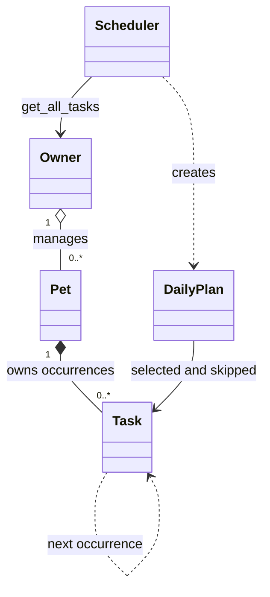

# 🐾 PawPal+

**Small routines. Happier pets.** A Python and Streamlit pet-care planner for CodePath AI110 Module 2.

Manage multiple pets, create dated care tasks, detect overlaps, and build an explained daily plan that respects your time. The scheduling logic works independently of Streamlit and is demonstrated in the CLI before the UI.

## Features

- **Multi-pet household:** create an owner, add pets, and view tasks across every pet.
- **Task management:** add, edit, complete, undo, and delete individual occurrences, including duration and priority.
- **Chronological sorting and filters:** filter by pet, pending/completed status, and selected/all dates.
- **Automatic recurrence:** completing a daily or weekly task creates a new, pending `Task` for the next day or seven days later. Repeating a completion does not duplicate it.
- **Conflict warnings:** detect exact time clashes and overlapping durations across the same or different pets. Adjacent tasks are allowed.
- **Priority scheduling:** consider high, medium, then low priority; break ties by time, then duration. Display the selected plan chronologically.
- **Owner constraints:** respect available hours and a remaining active-care budget; explain why each task is selected or skipped.
- **Session memory and CSV export:** keep the household through Streamlit interactions and download a generated plan.
- **Automated verification:** backend, CLI, and Streamlit UI tests, plus a GitHub Actions workflow.

## Run locally

Use **Python 3.11 or 3.12**. The implementation was tested locally with Python 3.12.14 and Streamlit 1.67.0.

```bash
git clone https://github.com/harshapriyag123/ai110-module2show-pawpal-starter.git
cd ai110-module2show-pawpal-starter
python -m venv .venv
```

Activate the environment:

```bash
# macOS / Linux / Git Bash
source .venv/bin/activate
```

```powershell
# Windows PowerShell
.\.venv\Scripts\Activate.ps1
```

Install and run:

```bash
python -m pip install -r requirements.txt
python main.py --date 2026-11-09
python -m streamlit run app.py
```

Open the local URL printed by Streamlit, normally `http://localhost:8501`. No API key is needed.

## Implementation summary

| Class | Responsibility |
|---|---|
| `Task` | Stores one occurrence's description, time, date, duration, priority, frequency, and completion. Returns the next occurrence on completion. |
| `Pet` | Owns tasks, validates edits, and attaches the next recurring instance through `mark_task_complete()`. |
| `Owner` | Owns all pets and preferences; exposes the shared `get_all_tasks()` collection. |
| `Scheduler` | Reads **only through the owner's task method** to sort, filter, detect conflicts, and select tasks across pets. |
| `DailyPlan` | Holds selected/skipped tasks, totals care time, and formats explanations for display/export. |

The UI stores an `Owner` in `st.session_state` and calls these backend methods. It recalculates displayed plans after edits and completion so stale tasks do not remain on screen. Stable IDs distinguish pets and tasks even when their names match.

### System architecture

The required Mermaid sources are [the initial design](diagrams/uml_draft.mmd) and [the final UML](diagrams/uml_final.mmd). `diagrams/uml.mmd` also contains the final diagram for compatibility with the starter repository.



## Smarter Scheduling

| Feature | Method(s) | Behavior |
|---|---|---|
| Time sorting | `Scheduler.sort_by_time()` | Sorts a copy by due date and time; does not reorder the pet's stored tasks. |
| Filtering | `Scheduler.filter_tasks()` | Combines pet ID/name, completion status, and due-date filters. |
| Conflict detection | `Scheduler.detect_conflicts()`, `_overlap()` | Reports full interval overlaps among pending tasks on the requested date across all pets. |
| Recurrence | `Task.mark_complete()`, `Pet.mark_task_complete()` | Creates and attaches a new dated instance; retains the completed occurrence as history. |
| Priority and constraints | `Scheduler.generate_schedule()` | Greedy priority-first selection within fixed start times, available hours, and the remaining budget. |
| Explainability | `DailyPlan.to_rows()`, `DailyPlan.skipped` | Shows a selection explanation and a specific conflict, availability, or budget reason for excluded tasks. |

Conflict detection and greedy conflict checking use straightforward pairwise comparisons, **O(n²)** in the worst case. This favors readability for a small household. The plan is deterministic; it does not promise a globally optimal combination or move tasks automatically. Skipped tasks remain pending and need the owner's review.

### Recurrence rules

Call `pet.mark_task_complete(task.id)` from an application. It calls `Task.mark_complete()` and stores the returned next occurrence automatically. Calling the task method directly returns the new instance for a caller to store.

- Daily advances from the completed task's **due date + 1 day**; weekly advances **+ 7 days**.
- Next instances have a new ID, preserve the series ID, and start pending with the same time, duration, and priority.
- Marking an already completed occurrence is idempotent. Undoing and recompleting reuses an existing next occurrence.
- A missed occurrence stays on its due date; use **All dates** to find overdue pending work. Future instances are created on completion rather than pre-generated indefinitely.
- Edits and deletion apply to one occurrence. Undo preserves an already generated future occurrence. There is no bulk series editor.

## Demo Walkthrough

1. Open Streamlit. Add your name, available hours, and remaining care budget in the sidebar, then save.
2. Add at least two pets, or click **Load sample household** in an empty household.
3. Open **Pets & tasks**, select a pet, and add a task with a date, time, duration, priority, and repeat frequency. Use **Create or edit** to edit a pending occurrence.
4. Choose a **Plan date**. The **Daily plan** tab warns about conflicts across pets. Click **Generate schedule** to see chronological tasks, reasons, total minutes, and excluded tasks needing attention.
5. In **Your care list**, filter by pet, status, and date. Mark a daily or weekly task complete and check the next date to see its new task instance. Undo and individual deletion are also available.
6. Download the plan as CSV. The **How it works** tab explains selection and recurrence rules.

The sample household has a high-priority 30-minute walk and a medium-priority breakfast at 08:00. With 75 available minutes, the planner selects the walk, a high-priority 09:00 reminder, and 18:00 playtime. It flags breakfast as conflicting and grooming as over budget. This demonstrates priority selection, conflict warnings, and explanations together.

### Sample Output

Actual output from `python main.py --date 2026-11-09`:

```text
Today's Schedule | 2026-11-09 | Jordan
Pets: Mochi (dog), Luna (cat)
All pending tasks, sorted by time:
  08:00 | Mochi: Morning walk
  08:00 | Luna: Breakfast
  09:00 | Luna: Medication reminder
  18:00 | Mochi: Playtime
  19:00 | Luna: Brush coat
Luna's pending tasks: Breakfast, Medication reminder, Brush coat
WARNING: Morning walk overlaps Breakfast.
Priority-based plan:
  08:00–08:30 | Mochi: Morning walk | 30 min | high
  09:00–09:10 | Luna: Medication reminder | 10 min | high
  18:00–18:20 | Mochi: Playtime | 20 min | medium
Care budget: 60/75 minutes
Needs attention:
  Luna: Breakfast - Conflicts with Mochi: Morning walk (high priority).
  Luna: Brush coat - Exceeds the remaining 15 minute care budget.
Completed Morning walk; new daily task: 2026-11-10 at 08:00 (pending).
```

## Testing PawPal+

```bash
python -m pytest
python -m pytest --cov=pawpal_system --cov=main --cov-report=term-missing
```

The **68 tests** cover completion and addition, new daily/weekly instances across month/year/leap-day boundaries, idempotence, sorting, filtering, retrieval through the owner, exact and interval conflicts, adjacent tasks, priority and budget selection, hours, zero-budget/empty cases, invalid inputs, identity-safe edits/deletes, CLI output, and real Streamlit forms/session state through `AppTest`.

Actual local result:

```text
68 passed in 4.38s

Name               Stmts   Miss  Cover
-------------------------------------
main.py               43      1    98%
pawpal_system.py     168      0   100%
-------------------------------------
TOTAL                211      1    99%
```

The coverage figures above measure the backend and CLI. UI behavior is exercised by eight additional `AppTest` scenarios within the 68 tests; the coverage figures do not represent UI line coverage. GitHub Actions is configured to run the demo and test suite on Python 3.11 and 3.12.

A browser visual check was attempted but blocked by environment isolation; the browser could not reach the local server. UI verification therefore relies on the eight passing Streamlit AppTest scenarios.

**Confidence level: 4/5 stars.** The automated cases support confidence in the defined single-owner workflow. Larger households, concurrent users, durable storage, time zones, and overnight availability would need more design and testing.

## Project files

| File | Purpose |
|---|---|
| `pawpal_system.py` | Dataclass models and scheduling algorithms |
| `main.py` | Standalone two-pet demo with sorting, filtering, conflict warnings, and recurrence |
| `app.py` | Streamlit interface backed by the same models |
| `diagrams/uml_draft.mmd` | Initial four-class UML |
| `diagrams/uml_final.mmd` | Final architecture with implemented methods |
| `tests/` | Backend, CLI, and Streamlit integration tests |
| `reflection.md` | AI-assisted design, tradeoffs, verification, and learning draft |
| `ai_interactions.md` | Factual record of the agent workflow |
| `.github/workflows/tests.yml` | Continuous test checks |

## Scope and next steps

Data is **session-only**: normal UI interactions retain it, but a new browser session, server restart, or connection reset may lose the household. CSV is a plan export, not a backup that can be restored. JSON persistence is a possible future extension.

Availability is one local, same-day window. Tasks spanning past midnight are rejected. The care budget represents **remaining pending work**, so completed tasks do not consume it. The system is a reminder planner and does not choose medication timing or care instructions.

The implementation includes the optional priority scheduling, agent workflow, and output formatting extensions. JSON persistence and a multi-model comparison were not implemented or claimed. Review and personalize the AI-assisted reflection before submitting it in the course portal.
